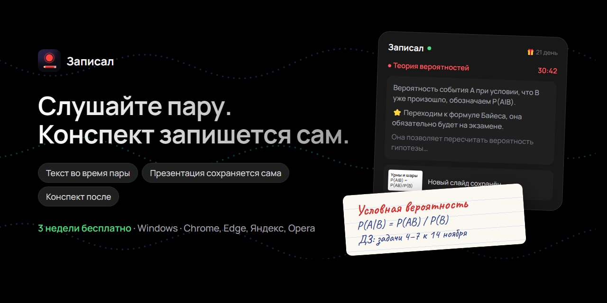
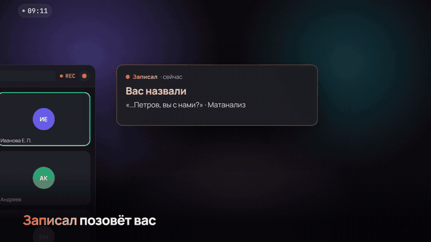

  
  
  
  

<h3 align="center">
  <a href="https://github.com/N1ck6/Zapisal/releases/latest/download/Zapisal-Setup.exe">⬇️ Скачать для Windows</a> ·
  <a href="https://n1ck6.github.io/Zapisal/?src=github">🎬 Сайт с демо</a> ·
  <a href="https://t.me/LandingZapisalBot?start=github">💬 Telegram-бот</a>
</h3>

**Записал** — помощник на онлайн-парах. Расширение браузера слушает вкладку с занятием, программа на компьютере
превращает речь в текст прямо во время пары, сама сохраняет презентацию преподавателя и после пары собирает конспект.
В звонок ничего не подключается, записи остаются у вас.

## ✨ Что умеет

| | |
|---|---|
| 📝 **Конспект после каждой пары** | Главное, определения, формулы, разобранные примеры, задания и сроки. PDF рукописным шрифтом и Markdown для Obsidian |
| 🗣️ **Текст во время пары** | Отвлеклись — дочитайте или спросите «что было только что?» |
| 🖼️ **Презентация сохраняется сама** | Каждый новый слайд, который показывает преподаватель, попадает в конспект |
| 🎬 **Звук и видео пары** | Можно пересмотреть любой момент |
| ⚡ **Лекция с YouTube за минуту** | Rutube и VK Видео тоже: конспект по субтитрам, без записи |
| 🔎 **Чат по всем лекциям** | Вопросы к зачёту — с ответом по вашим же расшифровкам |
| 🗂️ **Расписание** | Напомнит о паре и откроет ссылку; каждый предмет в своей папке |

Работает с Телемостом, МТС Линк, Сферумом, Zoom и всем, что открывается во вкладке Chrome, Edge, Яндекс Браузера или Opera.

## 🚀 Как начать

1. **Скачайте** [установщик](https://github.com/N1ck6/Zapisal/releases/latest/download/Zapisal-Setup.exe) и запустите его.
   Windows может сказать «Windows защитил ваш компьютер» — нажмите «Подробнее» → «Выполнить в любом случае»
   (у студенческого проекта нет платной подписи).
2. **Мастер настройки** за ~10 минут поставит расширение в браузер. Код и пробный период — сами, регистрация не нужна.
3. **Откройте пару** во вкладке и нажмите ● в окне расширения.

<b>Частые вопросы</b>

**Сколько стоит?** Первые 3 недели — всё бесплатно, без карты. Дальше, если понравится, — продление в Telegram-боте.

**Нужна ли видеокарта?** Нет. С видеокартой NVIDIA текст распознаётся прямо на компьютере, без неё — через бесплатный
облачный сервис (мастер подскажет, где взять ключ; из России может понадобиться VPN).

**Узнают ли преподаватель и одногруппники?** Нет: в звонок ничего не подключается, программа слушает только вашу вкладку.

**Где записи?** На вашем компьютере, в папке «Лекции». По желанию — копия на Яндекс Диск или Google Диск.

**Очные пары?** Загрузите запись с диктофона или видео — получите текст и конспект.

---

Ошибки и пожелания — <a href="https://t.me/LandingZapisalBot?start=github">в Telegram-бот</a> или кнопкой «Написать разработчику» в программе. 
<a href="https://n1ck6.github.io/Zapisal/privacy.html">Политика конфиденциальности</a>

